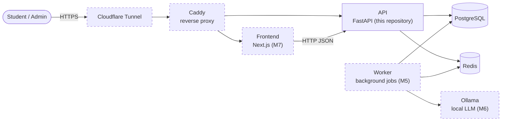

# dtm-backend

Backend API for the DTM AI tutor: a practice platform that prepares students for the DTM university
entrance exam by finding weak topics, planning daily practice and explaining mistakes in Uzbek.
It is a modular monolith built with FastAPI, async SQLAlchemy 2, PostgreSQL and Redis.

## Status: milestone M0 (foundation)

M0 builds the pipeline every later feature goes through. There are no user features yet, by design.

| Works now | Not built yet |
| --- | --- |
| App skeleton with `GET /health` (liveness) and `GET /ready` (PostgreSQL + Redis) | Staging deployment, Cloudflare Tunnel, CD (M0-10, M0-11: need the home server) |
| Quality gates: ruff, mypy `--strict`, import-linter, vulture, file-length and `noqa` checks | Daily backups and a tested rollback (M0-12) |
| Docker image and a local compose stack | Error tracking (Sentry or GlitchTip, part of M0-08) |
| Database layer and Alembic pipeline (the first migration is empty on purpose) | Any student-facing feature (starts in M1) |
| Tests against real PostgreSQL and Redis containers, 80% branch-coverage floor | |
| JSON logs, `X-Request-ID`, RFC 9457 error responses | |
| CI workflow with jobs `lint`, `typecheck`, `test`, `migrations`, `build`, green on GitHub | |

## Quick start (about 5 minutes)

You need Docker with Compose v2 (`docker compose`), GNU make, git and curl. Nothing else is needed to
run the stack: the API is built inside its image. The repository may be private; cloning it then
needs access granted by the owner.

```bash
git clone https://github.com/lutfullo-hbai/dtm-backend-.git
cd dtm-backend-
make up
```

`make up` creates `.env` from `.env.example` if it is missing, builds the image, starts PostgreSQL and
Redis, applies migrations in a one-off container, starts the API and waits up to 60 seconds for
`/ready` to answer 200. Then open:

- <http://127.0.0.1:8000/health> — the process is running
- <http://127.0.0.1:8000/ready> — PostgreSQL and Redis are reachable
- <http://127.0.0.1:8000/docs> — Swagger UI

All ports are bound to `127.0.0.1` only. Defaults (change them in `.env`): API `8000`
(`API_HOST_PORT`), PostgreSQL `55432` (`POSTGRES_HOST_PORT`), Redis `56379` (`REDIS_HOST_PORT`).
If a port is taken, `make up` fails; set another value in `.env` and run it again.
`POSTGRES_PASSWORD` is inserted into the containers' `DATABASE_URL` unescaped, so a local password
may contain only letters, digits and `-_.~`; a character such as `@`, `:` or `/` breaks the URL
(the API then fails at startup with a misleading "host is missing").

`make logs` follows the logs, `make ps` lists the containers. `make down` stops and removes the
containers; the database volume is kept.

## Developer workflow

Running checks and tests on the host needs [uv](https://docs.astral.sh/uv/); CI pins uv 0.12.18.
Python 3.13.15 is pinned in `.python-version`, and uv installs it. `make help` lists every target.

| Command | What it does |
| --- | --- |
| `make install` | Install the locked dependencies, including the dev group (`uv sync --frozen`) |
| `make lint` | All static checks, changes no files: `ci-lint`, then `typecheck` (the pre-commit hook runs this) |
| `make ci-lint` | ruff, import contracts, vulture, file length, `noqa` and module-init checks (CI job `lint`) |
| `make typecheck` | mypy `--strict` only (CI job `typecheck`) |
| `make format` | Apply ruff fixes and formatting |
| `make test` | All tests with branch coverage; fails under 80% (CI job `test`). **Needs Docker** |
| `make test-unit` | Only tests that need no Docker |
| `make test-integration` | Only tests against real PostgreSQL and Redis containers. Needs Docker |
| `make test-migrations` | Migration history tests (CI job `migrations`). Needs Docker |
| `make migrations-roundtrip` | Upgrade head, **downgrade base**, upgrade head, `alembic check` (CI job `migrations`). See the warning below |
| `make openapi` | Regenerate `docs/api/openapi.json` (`make openapi-check`, run in CI job `migrations`, fails if it is stale) |
| `make image` | Build the API image and check it runs as non-root and imports (CI job `build`). Needs Docker |
| `make migrate` | Apply migrations on the host (`alembic upgrade head`) against `DATABASE_URL` |
| `make migration name="add users"` | Autogenerate a migration; review the file before committing |
| `make downgrade` | Revert the latest migration (`alembic downgrade -1`) |
| `make migrate-docker` | Apply migrations inside the compose stack |

To reproduce a failed CI job, run the targets named for it above. The `lint` job also checks the
pull request's commit messages and title. Integration tests start their own containers and **fail,
not skip**, when Docker is unavailable.

**Warning:** `make migrations-roundtrip` reverts every migration (`downgrade base`) in the database
that `DATABASE_URL` points to, deleting its tables and data. Run it only against a disposable
database, with `APP_ENV=test`, as CI does.
The target enforces this: without `APP_ENV=test` in its environment it refuses to run (exit status 2).

Host tools read real environment variables, not `.env`. Before `make migrate`, `make migration` or
`make downgrade`, export it in your shell: `set -a && . ./.env && set +a` (the stack from `make up`
must be running).

Install the git hooks once after `make install` with `uv run pre-commit install`. It installs both
hooks (`default_install_hook_types: [pre-commit, commit-msg]`): `make lint` before each commit, and
a Conventional Commits check of the message (types `feat`, `fix`, `refactor`, `perf`, `test`,
`docs`, `ci`, `chore`; first line at most 72 characters).

## Architecture

The target system on the home server. Dashed boxes are not built yet; today only the API,
PostgreSQL and Redis exist, in the local compose stack. Full description, with the reasons:
[docs/architecture.md](docs/architecture.md).



## Project layout

```text
app/
  main.py            app factory (create_app)
  core/              config, db, errors, logging, middleware, redis, request id
  modules/health/    router -> service -> repository -> schemas (layering enforced by import-linter)
migrations/          Alembic env and versions/
tests/               unit/, integration/, api/, migrations/, support/
scripts/             OpenAPI export, file-length check
docs/                api/openapi.json, architecture.md, adr/
compose.yaml         local development stack only (api, migrate, postgres, redis)
Dockerfile           multi-stage image, runs as a non-root user
```

## Conventions

**Errors.** Every error response is `application/problem+json` per
[RFC 9457](https://www.rfc-editor.org/rfc/rfc9457), with `type`, `title`, `status`, `detail`, a stable
snake_case `code` for clients to branch on, and the `request_id`. Raise a subclass of `AppError` from
`app.core.errors`; never build error responses by hand.

**Logging.** Logs go to stdout, one event per line: JSON in containers (`LOG_FORMAT=json`), readable
text locally if you choose `LOG_FORMAT=console`. Each request gets an `X-Request-ID` (a well-formed
incoming one is reused, otherwise a UUIDv7 is generated); it is returned in the response header and
attached to every log line of that request. Queries slower than `SLOW_QUERY_MS` (100 ms) are logged.

**Configuration.** All settings come from environment variables, read by `app/core/config.py`.
`.env.example` lists every variable with local-only placeholder values. Never commit `.env`.

**Migrations.** Migrations are a separate step, never run at application startup: compose runs a
one-off `migrate` container before `api`, and deployments will do the same. Every migration must
upgrade and downgrade cleanly and match the models; `tests/migrations/` checks this (single head,
up/down consistency, models match the schema).

## Documentation

- [Architecture](docs/architecture.md): system context, containers, module boundaries, cross-cutting conventions
- [Conventions](docs/conventions.md): the binding rules for code (configuration, HTTP and error contract,
  logging, database, resource budget, quality gates)
- [Architecture decision records](docs/adr/README.md), including
  [0001 modular monolith](docs/adr/0001-modular-monolith.md),
  [0002 FastAPI + SQLAlchemy](docs/adr/0002-fastapi-sqlalchemy.md),
  [0003 three-branch flow](docs/adr/0003-three-branch-flow.md),
  [0004 home server + Cloudflare Tunnel](docs/adr/0004-home-server-cloudflare-tunnel.md),
  [0006 three repositories](docs/adr/0006-three-repositories.md)
- API reference: `/docs` on a running stack, or [docs/api/openapi.json](docs/api/openapi.json)
  (generated from code; never edit it by hand)
- CONTRIBUTING.md: not written yet (owner's M0-02 item). Until then, branch and commit rules are in
  ADR 0003 and the commit-msg hook.

## License

Not yet chosen. Until a license is added, no rights to reuse this code are granted.

---

Owner: project owner (backend maintainer). Last reviewed: 2026-11-17, end of M0 (CI green on
GitHub, run 43232548746). Update at the end of each milestone, and whenever a `make` target, port
or required tool changes.
