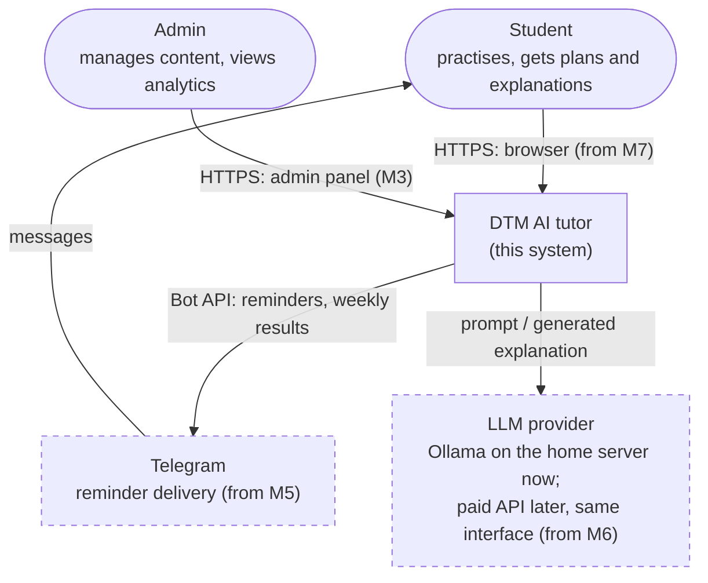
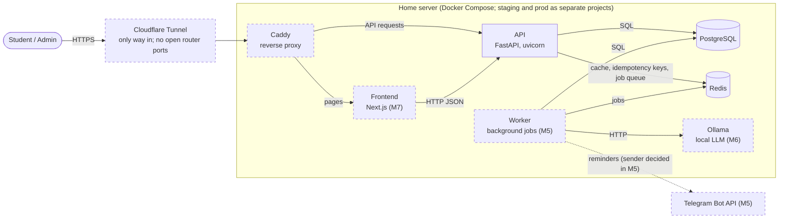

# Architecture

| | |
|---|---|
| Status | Skeleton, as of milestone M0 (2026-11-12) |
| Owner | Project owner (backend maintainer) |
| Update when | A module, container or cross-cutting convention is added or changed — in the same PR |

DTM AI tutor is a practice platform that prepares students for the DTM entrance exam: it diagnoses weak topics,
plans daily practice and explains mistakes in Uzbek with an LLM. The backend is a modular monolith (one FastAPI
application plus a separate background worker) running on a single home server behind Cloudflare Tunnel.

The decisions behind this shape are recorded as ADRs:

- [ADR 0001 — Modular monolith](adr/0001-modular-monolith.md)
- [ADR 0002 — FastAPI and SQLAlchemy](adr/0002-fastapi-sqlalchemy.md)
- [ADR 0003 — Three-branch flow](adr/0003-three-branch-flow.md)
- [ADR 0004 — Home server and Cloudflare Tunnel](adr/0004-home-server-cloudflare-tunnel.md)
- [ADR 0006 — Three repositories](adr/0006-three-repositories.md)
- ADR 0005 is reserved for the M1 LLM benchmark.

The rules code must follow (configuration, HTTP and error contract, logging, database, resource budget, quality
gates) are in [conventions.md](conventions.md).

Diagrams use Mermaid `flowchart`, not Mermaid's `C4Context` syntax: the C4 diagram type is marked experimental by
Mermaid and its layout is hard to control, while `flowchart` renders reliably on GitHub. The diagrams follow the
C4 levels (context, containers); dashed boxes are not yet built.

## 1. System context (C4 level 1)



The LLM provider is reached through one provider interface in the `tutor` module, so replacing Ollama with a paid
API is a configuration and adapter change, not a change to callers.

## 2. Containers (C4 level 2)



| Container | Built yet (as of 2026-11-12) | Role |
|---|---|---|
| Cloudflare Tunnel | No (M0-10, pending the owner's home server) | Public entry without a static IP or open ports |
| Caddy | No (M0-10, pending the owner's home server) | Routes requests to API or frontend |
| API (FastAPI) | Locally only (local compose) | HTTP API; operational endpoints `/health`, `/ready` |
| PostgreSQL | Locally only (local compose) | System of record; schema changed only by Alembic migrations |
| Redis | Locally only (local compose) | Cache, idempotency keys (M3), job queue (M5), live ranking (M8) |
| Worker | No (M5) | Background jobs; library (`arq` or `taskiq`) chosen by ADR in M5 |
| Ollama | No (M6) | Local LLM, called only by the worker |
| Frontend | No (M7) | Next.js app from the separate frontend repository |

Today the API, PostgreSQL and Redis run only in the backend's local `compose.yaml`. Staging does not exist yet: its
compose files, the Tunnel and Caddy arrive with M0-10 in the infra repository, once the owner's home server is ready.

**Only the worker calls the LLM.** Generating an explanation takes seconds; doing it inside an API request would hold
a uvicorn worker and a DB connection for that time. The API instead accepts the request (`202 Accepted`), queues a
job in Redis, and the worker calls the LLM and stores the result. API and worker share the same PostgreSQL and Redis.

Which process sends reminders to Telegram is decided in M5 (the dashed edge shows the expected choice, the worker,
because reminders are scheduled jobs).

## 3. Module boundaries

```
app/
  core/          config, db, logging, errors, middleware — imports no module
  modules/<name>/router.py -> service.py -> repository.py (+ models.py, schemas.py)
```

The content pipeline (`pipeline/`, M1) sits outside `app/` and is independent of the application.

| Module | Responsibility | Milestone | Exists after M0 |
|---|---|---|---|
| `core` | Config, DB engine and session, logging, errors, request-ID middleware | M0 | Yes |
| `health` | `/health` liveness and `/ready` readiness | M0 | Yes |
| `auth` | Registration, JWT, sessions, roles | M2 | No |
| `content` | Subjects, topic graph, questions, generators, source registry | M3 | No |
| `practice` | Practice sessions, answers | M3 | No |
| `mastery` | Mastery model, diagnostics | M4 | No |
| `planner` | Daily plan, spaced repetition | M5 | No |
| `notifications` | Reminders via Telegram bot: today's plan, broken streak, weekly result | M5 | No |
| `stats` | Student statistics: progress, accuracy per topic, time spent, estimated score | M5 | No |
| `tutor` | AI explanations, LLM provider interface, cache (voice and avatar in M13) | M6 | No |
| `exam` | Live mock exam, ranking, integrity checks | M8 | No |
| `analytics` | Platform events and reports for admins | M10 | No |

Rules, checked in CI by `import-linter` (except where noted):

1. **Layers inside a module:** `router -> service -> repository`. A router never touches a repository or the session
   directly. ORM models are never returned from the API (Pydantic `*Read` schemas are); `import-linter` cannot see
   this, so it is enforced by review and the convention that every route declares a `response_model`.
2. **Across modules only through the service:** a module never imports another module's repository, models or
   tables. It calls the other module's `service`. This keeps each module extractable into its own service later.
3. **Dependency direction:** `core <- modules`. Modules import `core`; `core` never imports `app.modules`.

## 4. Cross-cutting conventions (as of M0)

A summary; the binding, detailed rules (every setting, error code, log field and budget) are in
[conventions.md](conventions.md).

**Configuration.** Everything comes from environment variables, validated at startup by `pydantic-settings`; the
app refuses to start if a required value is missing or invalid. `.env.example` lists every variable; `.env` is never
committed. The one environment switch is `APP_ENV` (`local`, `test`, `staging`, `production`).

**Health vs readiness.**

| Endpoint | Question it answers | Touches DB/Redis | Failure |
|---|---|---|---|
| `GET /health` | Is the process alive? | No | Intended: the container is restarted. TODO(M0-10): Compose healthchecks only mark it unhealthy; the restart mechanism is set up with the server |
| `GET /ready` | Can it serve traffic now? | One `SELECT 1` + one `PING`, concurrent, each time-limited | `503` problem with per-dependency `checks` |

Deploys wait for `/ready`; liveness probes use `/health`, so a database outage does not cause restart loops.
Both endpoints sit outside `/api/v1`; business endpoints go under `/api/v1` from M2.

**Errors.** Every error is RFC 9457 `application/problem+json` with `type`, `title`, `status`, `detail`, plus a
stable snake_case `code` (the frontend's key) and `request_id`. Responses never contain stack traces, SQL or
hostnames; those go to the log.

**Request ID.** `X-Request-ID` is reused if the caller sends a safe value, otherwise generated (UUIDv7). It is
returned on every response, including errors, and appears in every log line for that request.

**Logging.** `structlog` writes one JSON object per line to stdout; the container runtime collects it. One
`http_request` event per request (method, path, status, duration); a successful `/health` probe's event is logged at
DEBUG, so liveness polling does not flood INFO. SQL slower than `SLOW_QUERY_MS` (default 100 ms)
logs a `slow_query` warning without parameters. Secrets and `Authorization` headers are never logged.

**Database migrations.** The schema changes only through Alembic. Migrations run as a separate one-off step before
the new app version starts; the app never migrates at startup. Destructive changes are split over two releases
(expand, then contract) so the previous image keeps working — this is what makes rollback safe.

## 5. Not yet decided

- Error tracking (Sentry or self-hosted GlitchTip): listed in M0-08, deferred pending the owner's decision.
- Worker library (`arq` or `taskiq`): ADR in M5.
- LLM model and provider: benchmark in M1, ADR 0005.
